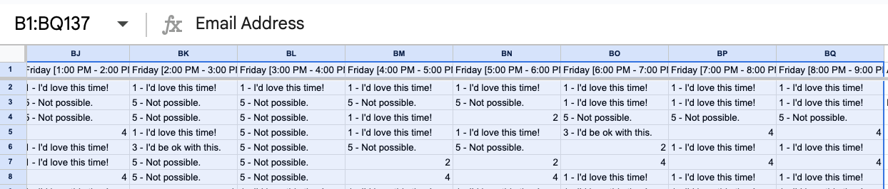

# 61a-OH-scheduler
Machine-driven TA office-hour scheduling for CS 61A / Data C88C.


---
updated fall 2025 by Christian

## Setup

1. **Clone & authenticate**
   - Clone this repo.
   - Log into the [CS61A SPA](https://calnet.berkeley.edu/calnet-departments/special-purpose-accounts-spa/log-spa) Google account  and share both the availabilities and demand spreadsheets with `oh-scheduler@cs-61a-website.iam.gserviceaccount.com`.
   - In [Google Cloud Console](https://console.cloud.google.com/) → _IAM & Admin_ → _Service Accounts_, create/download a service account key for the scheduler. Save it as `credentials/credentials.json`.
   - Download the OAuth client (used for Calendar pushes) and save it as `credentials/oauth_credentials.json`. The OAuth token generated on first run is stored as `credentials/token.json`.
   - If you want to script Google Forms creation, also enable the Forms API + Drive API in the same project and share the form template with the service account.

2. **Python dependencies**
   - Easiest: run `python setup_env.py` to create `.venv/` and install everything from `configs/requirements.txt`.
   - Manual alternative:
     ```bash
     python -m venv .venv
     source .venv/bin/activate  # Windows: .venv\Scripts\activate
     pip install -r configs/requirements.txt
     ```

3. **Configure per-course settings**
   - Copy one of the existing config templates under `configs/` (e.g. `61A_config.json`).
   - Update sheet URLs, semester metadata, and calendar defaults.
   - Make sure the ranges (`AVAILABILITIES_RANGE`, `DEMAND_RANGE`) match each sheet. You can type the range (e.g. `B1:BQ`) into the Google Sheets name box to confirm.
   - Optional fixed TA assignments live under `configs/fixed_tas/`. Point the `fixed_tas` field at the CSV for your class (`fixed_tas/61A_FIXED_TAs.csv`, etc.).

4. **Validate access (optional but recommended)**
   ```python
   >>> from src import validation
   >>> validation.test()
   ```
   This confirms the API client can read the configured spreadsheets and that values can be parsed.

### Detailed Setup Walkthrough

1. Log into the CS61A SPA account.
2. Make copies of the Availabilities and Demand spreadsheets you will use for the semester.
3. Clone this repo. The project does **not** ship with Google credentials; you must supply them.
4. Share both sheets with `oh-scheduler@cs-61a-website.iam.gserviceaccount.com`.
5. In Google Cloud Console:
   - Navigate to **IAM & Admin → Service Accounts**.
   - Locate the scheduler service account and download a JSON key (**Add Key → Create new key → JSON**).
   - Save the file as `credentials/credentials.json`. (_Fun fact_: you cannot download that exact key again; regenerate if needed.)
   - Download the OAuth client for the scheduler (used for Calendar invites) and place it at `credentials/oauth_credentials.json`.

6. Confirm the spreadsheet ranges align with your copies:
   ```python
   AVAILABILITIES_RANGE = 'Form Responses 1!B1:BQ'
   DEMAND_RANGE = 'Demand!A2:E'  # adjust if the demand sheet includes more metadata columns
   ```

   Use the Google Sheets name box to highlight the ranges and make sure they capture all of the relevant cells.

   

   As of Fall 2025, the form responses range is `B1:BQ`. If additional columns are added, update the config accordingly.

   

7. Open `src/state.py` and verify the column indices listed under `StaffMember` still match your form responses. If the form changes, update those constants.
8. If validations fail, check `src/utils.py:get_availabilities` — this is where string values from the spreadsheet are coerced into integers or default values. Adjust fallback logic there if staff input unconventional responses.
9. Once confident in the config, run the validation helper (`validation.test()`) to ensure the Sheets API credentials are correct and the data can be parsed end-to-end.
10. Gather any existing pickle files from teammates (drop them into `.artifacts/pickles/<class>/`) if you want to resume mid-semester instead of recomputing earlier weeks.
11. Launch the CLI with `python schedule.py` (optionally `-c CLASSNAME` defaults to the class in config.json if no -c is passed) to run the optimizer or calendar push.

---

## Project Layout

- `schedule.py` — CLI entrypoint for running the scheduler and optionally creating Google Calendar events.
- `src/runner.py` — main scheduler workflow invoked by the CLI.
- `src/`
  - `algorithm.py` — CVXPY optimization that produces weekly assignments.
  - `calendar_time.py` — OAuth helpers and Calendar API plumbing.
  - `config_read.py` — shared config loading/validation helpers.
  - `paths.py` — single source of truth for filesystem locations.
  - `state.py` — core state machine (staff roster, historical assignments, serialization).
  - `utils.py` — spreadsheet readers, serialization helpers, misc utilities.
  - `validation.py` — config/spreadsheet validation utilities.
  - `send_email.py` — legacy calendar invite script (kept for reference).
- `configs/` — course configs plus supporting assets (`fixed_tas/*.csv`).
- `outputs/` — generated CSV exports (`<class>_sum_assignments_weekX.csv`, detailed weekly grid under `outputs/weekly_assignments/`).
- `.artifacts/numpy/` — intermediate `.npy` dumps of demand and assignment tensors.
- `.artifacts/pickles/<class>/` — serialized `State` objects for each scheduled week (supports out-of-order runs).
- `.artifacts/logs/` — timestamped log files capturing run details and solver diagnostics.
- `credentials/` — Google service account key, OAuth client, and cached token.
- `setup_env.py` — helper script that bootstraps a virtual environment and installs dependencies.

---

## Running the Scheduler

```bash
python schedule.py [-c CLASSNAME]
```

The CLI flow:

1. Choose the course (`schedule.py` will auto-list every config under `configs/`). Passing `-c CLASSNAME` skips the prompt if the class exists.
2. Choose whether to run the scheduler or send calendar events.
3. When running the scheduler:
   - Confirm the sheet links/ranges from the config.
   - Enter the week number you want to schedule. You can run weeks out of order; the scheduler will reuse previously saved state if available and bootstrap new ones when missing.
   - Decide whether to rerun from the start or only compute the requested week. States are serialized to `.artifacts/pickles/<class>/<week>.pkl`.
   - On success the run exports:
     - `outputs/<class>_sum_assignments_week<week>.csv` — summary of hours per TA.
     - `outputs/weekly_assignments/<class>_assignments_week<week>.csv` — detailed grid (hour × weekday, comma-separated emails).

The optimization results and demand tensor are also cached in `.artifacts/numpy/`.

---

## Google Forms Helper

Use `src/forms_helper.py` to copy a Google Form template and replace placeholders (e.g., `{{NAME}}`, `{{DATE}}`). Example:

```python
from src.forms_helper import create_form_from_template

new_form_id = create_form_from_template(
    template_form_id="1AbcTemplateId",
    replacements={"{{NAME}}": "Ada", "{{DATE}}": "Oct 12"},
    new_title="OH Intake for Ada"
)
print(f"Edit link: https://docs.google.com/forms/d/{new_form_id}/edit")

# or populate placeholders from a scheduler config (class/semester):
from src.forms_helper import create_form_from_template_with_config

new_form_id = create_form_from_template_with_config(
    template_form_id="1AbcTemplateId",
    config_path="configs/config.json",  # or another config file
    extra_replacements={"{{NAME}}": "Ada"}  # optional
)
print(f"Edit link: https://docs.google.com/forms/d/{new_form_id}/edit")
```

Ensure the template form is shared with the service account and that the Forms API + Drive API are enabled in the same GCP project as `credentials/credentials.json`.

---

## User Workflow (High-level)

1. **Prepare configuration**
   - Update the chosen JSON under `configs/` with sheet URLs, semester metadata, and calendar defaults.
   - Confirm the ranges (`AVAILABILITIES_RANGE`, `DEMAND_RANGE`) match the sheets.
   - Point `fixed_tas` to a CSV under `configs/fixed_tas/` if you have guaranteed staffing commitments.

2. **Gather spreadsheets**
   - Ensure the availabilities form responses sheet includes the expected numeric ratings for each day/hour slot.
   - Verify the demand sheet lists each week, day, start/end hour, staff count, and any optional metadata columns (location, description, total staff, comments).

3. **Run the scheduler**
   - Execute `python schedule.py` (add `-c CLASSNAME` to preselect a course).
   - Select the course and choose to “Run the OH scheduler”.
   - Enter the week number you want to schedule. Enable “rerun from the beginning” if you need to rebuild past state.
   - Review the resulting CSV files under `outputs/`.

4. **Send calendar events (optional)**
   - Re-run `python schedule.py`, choose the same course, and select “Send calendar events”.
   - Provide the week number, optionally include fixed TAs, review the preview, and confirm to create events on the configured Google Calendar.

5. **Iterate weekly**
   - Repeat the scheduling process each week, or rerun multiple weeks at once to catch up. The hidden `.artifacts/pickles/<class>/` folder stores cumulative state.

---

## Calendar Export

Selecting the “Send calendar events” option prompts for a week number and reads the detailed CSV. Before creating events the CLI:

1. Optionally merges “fixed TA” assignments.
   - If the config’s `fixed_tas` path points to a CSV and you opt in, staff listed there are automatically added to the matching (day, hour) slots.
2. Loads metadata from the demand sheet.
   - `src.runner.load_weekly_demand_metadata` re-parses the demand sheet for the chosen week.
   - Additional columns in the demand sheet’s range (after staff counts) can provide per-slot overrides:
     - Column 6 (`row[5]`): Location override.
     - Column 7 (`row[6]`): Description text.
     - Column 8 (`row[7]`): Suggested “total staff” note (rendered in the event description).
     - Column 9 (`row[8]`): Free-form comments.
   - When present, these values replace the config defaults for that specific slot.
3. Displays a preview of the events (time, location, description, attendees) before asking for final confirmation.

Events are created on the calendar ID configured in the JSON file and inherit the default reminders (24 hr email, 10 min popup).

---

## Troubleshooting & Tips

- **Bad spreadsheet values** — `src/utils.py` aggressively coerces string inputs to integers. If you see parsing errors, check the relevant `try`/`except` blocks to tweak fallbacks.
- **Weeks out of order** — `src/runner.py` will deserialize any prior week stored under `.artifacts/pickles/<class>/`. If a pickle is missing you’ll see a warning and the run will proceed using fresh demand/availability data.
- **Regenerating historical data** — Delete the relevant pickle files and rerun the scheduler starting from the earliest missing week.
- **Validation** — Re-run `validation.test()` whenever you change sheet links or form questions to ensure the parser still matches the current schema.
- **Logs** — Each run emits a timestamped log under `.artifacts/logs/` containing solver diagnostics and progress notes; check these if something goes wrong silently.
- **Zero-hour staff** — TAs with a weekly target of 0 are now hard-blocked from being assigned any hours. The algorithm enforces this and `src/runner.py` raises an error if a violation slips through.

---

## Design Notes

### Core Data Structures

- **State (`src/state.py`)**
  - Tracks the current week number, weeks remaining, course staff roster, previous assignments, and demand tensors.
  - Stores `StaffMember` objects (email, availability matrix, hour commitments, preferences) keyed by email with a bidirectional index mapping for stable ordering.
  - Serializes each week’s state to `.artifacts/pickles/<class>/<week>.pkl` after stripping the `prev_state` pointer to avoid recursive serialization. On load, `utils.deserialize` re-links the chain and transparently converts legacy pickles (pre-`src` package layout).

- **Assignments**
  - The optimizer returns a boolean tensor `(staff, remaining_weeks, 5 days, 12 hours)`; the scheduler keeps only the first week slice.
  - Derived CSV exports flatten this data for consumption by course staff and the calendar exporter.

### Execution Flow

1. `src/runner.py` reads the selected config via `src/config_read.read_config`.
2. `src/utils.get_availabilities` and `get_demand` fetch spreadsheet data and convert it into numeric numpy arrays.
3. A new `State` instance incorporates the previous week (if any), updates staff information, and assembles algorithm inputs:
   - Demand window for current/future weeks.
   - Historical assignments for “day one” staff to enforce consistency.
   - Staff availability, remaining hours, contiguous hours preferences, etc.
4. `src/algorithm.run_algorithm` solves the CVXPY optimization problem. Intermediate tensors are cached to `.artifacts/numpy/assignments.npy` and `demand.npy`.
5. The resulting assignments update staff hour balances; the state is serialized; CSV exports are produced.
6. When requested, calendar export pipelines through `load_weekly_demand_metadata` and `parse_assignments_from_csv` to build rich event payloads (including fixed TA supplements and demand-sheet overrides).

### Persistence & Directories

- `paths.ensure_directories()` creates all runtime folders (`.artifacts/*`, `credentials/`) on startup.
- Pickles and numpy arrays are hidden from version control via `.gitignore`.
- Config assets (including fixed TA rosters) live alongside the JSON configs for easier sharing between course instances.

---

## Credits

- Original CLI + documentation by Shm.
- Subsequent refactors added hidden artifact caches, out-of-order week support, demand metadata integration, and the consolidated documentation you’re reading now by Chris.
